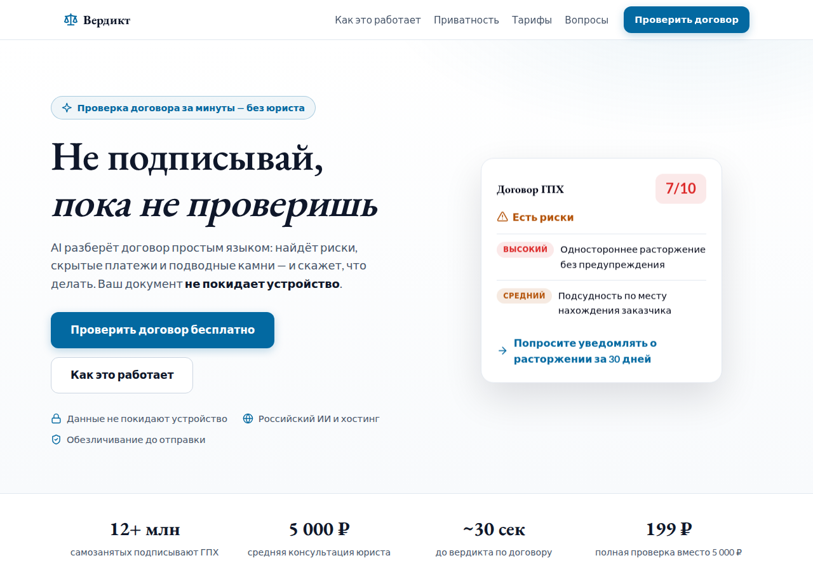

# Вердикт — AI-проверка договора до подписания

[](.github/workflows/ci.yml)
[](tsconfig.base.json)
[](#тестирование)
[](LICENSE)
[](#архитектура-приватности)

**«Не подписывай, пока не проверишь».** Веб-сервис, который за минуты объясняет
простым языком, что вы подписываете: находит риски, скрытые платежи и
«подводные камни» в договорах. **Персональные данные не покидают устройство
пользователя**: на сервер и в ИИ уходит только обезличенный текст документа.



---

## Проблема и решение

| Проблема                                                        | Решение                                                      |
| --------------------------------------------------------------- | ------------------------------------------------------------ |
| Юрист берёт 3 000–5 000 ₽ за консультацию по одному договору    | Проверка — 199 ₽, вердикт за секунды                         |
| Люди подписывают ГПХ, займы и оферты, не читая «мелкий шрифт»   | AI разбирает документ и выделяет риски по пунктам            |
| Загружать договор с паспортными данными на чужой сервер страшно | Маскирование персональных данных **на клиенте**, до отправки |

Работает для 10 типов документов: ГПХ, услуги, оферты, подряд, аренда, кредит,
ипотека, займ, купля-продажа, договоры с самозанятыми.

---

## Ключевые сильные стороны

### 🔒 Приватность как архитектура, а не обещание

Пайплайн устроен так, что **сервер физически не получает исходный текст**:

1. **Клиент** (браузер) извлекает текст из PDF/DOCX/скана/HTML/TXT и заменяет
   персональные данные на плейсхолдеры (`[ФИО]`, `[ПАСПОРТ]`, `[СНИЛС]`, …).
2. **Пользователь** видит список замен и подтверждает их галочками — контроль
   остаётся у человека.
3. **Сервер** получает только обезличенный текст и прогоняет его через
   NER-предохранитель (ловушка для остатков ПДн).
4. **ИИ** (YandexGPT) формирует вердикт; текст живёт только в памяти, без
   логирования содержимого и без хранения.

### 🧠 Маскирование под российские документы

- **26 правил** и **12 типов плейсхолдеров**: ФИО, паспорт (серия/номер),
  СНИЛС, ИНН, ОГРНИП, телефоны, email, расчётные счета, адреса, даты рождения,
  кем выдан, код подразделения, организации.
- **Защита от избыточного маскирования**: деньги, даты договора, ОГРН, статьи
  закона, номера пунктов и договоров остаются как есть — юристу и ИИ они нужны.
- **Корпуса для проверки**: 10 синтетических договоров + 20 текстов
  «боевых» форматов (ГПХ, кредиты, аренда, доверенности, оферты). Все имена,
  телефоны, email и организации в корпусе — вымышленные; сторонние исходники
  документов в репозиторий не попадают.
- **Самостоятельные фикстуры**: DOCX, PDF и HTML для тестов извлечения
  генерируются скриптом `scripts/make-fixtures.mjs` и содержат только
  вымышленные данные (`info@example.com`, «Ромашка»).
- **Скрипт аудита** (`npm run audit`) ищет в обезличенном выводе остаточные ПДн:
  тройки заглавных слов, телефоны, email, ИНН/ОГРНИП, паспорта, счета, СНИЛС,
  даты рождения.

### 🛡️ NER-предохранитель с бенчмарком

Сервер ловит ПДн, которые клиент мог пропустить: модель
`Gherman/bert-base-NER-Russian` (ONNX int8, ~178 МБ, ленивая загрузка) через
`@huggingface/transformers`, разметка под российские паспортные данные
(ФИО, город, улица, регион).

Замеры на корпусе: **11/11 имён найдено, 0 ложных срабатываний, ~321 мс на
документ на CPU**. Клиентская NER-модель была сознательно отклонена: 100+ МБ
скачивания для пользователя — плохой UX, серверный предохранитель решает ту же
задачу без него.

### ⚖️ Вердикт-движок

- Промпты под каждый из 10 типов документов, таксономия из **15 категорий
  рисков** (неустойка, подсудность, одностороннее расторжение, скрытые
  комиссии и т.д.).
- Строгая валидация ответа LLM: устойчивый парсинг JSON (markdown-обёртки,
  мусор вокруг), ограничение оценки 0–10, нормализация уровня угрозы, безопасный
  фолбэк.
- Живой замер: **~3–4 секунды** на вердикт через YandexGPT (`yandexgpt-lite`).

### 🧪 Тесты и инженерные практики

- **147 unit-тестов** (Vitest) + **10 e2e-сценариев** (Playwright): загрузка
  PDF/DOCX/HTML, ревью замен, копирование, вердикт с сервера, мок-оплата.
- **TDD**: тесты пишутся до кода; правила зафиксированы в
  [CONTRIBUTING.md](CONTRIBUTING.md) и проверяются в CI.
- **CI** (GitHub Actions): typecheck → lint → проверка отсутствия секретов →
  unit → e2e → аудит маскирования.
- Строгий TypeScript без `any`, ESLint, Prettier, husky + lint-staged.

### 💳 Оплата (мок ЮKassa)

Полный цикл оплаты в моковом режиме, без сети и без ИП:

```
POST /api/payments {plan: "pack3"}  →  платёж mock_…, статус pending
POST /api/payments/:id/confirm      →  статус succeeded (идемпотентно)
POST /api/verify {…, paymentId}     →  вердикт + paid: true (без оплаты — 402)
```

Реальная интеграция ЮKassa описана в `apps/server/src/payments.ts` (TODO):
Basic-авторизация, `Idempotence-Key`, вебхук `payment.succeeded`.

### 📄 Юридическая рамка

Черновики [оферты](docs/oferta.md) и
[политики конфиденциальности](docs/politika-konfidencialnosti.md): сервис
работает с обезличенными данными, ответственность за загружаемый контент — на
пользователе, согласие на ИИ-обработку — в оферте (ст. 6 ч. 5 152-ФЗ).
Документы помечены как черновики для проверки юристом.

---

## Архитектура

```
┌──────────────────────────── Браузер ────────────────────────────┐
│  apps/web (Vite + TS)                                           │
│  ├─ извлечение текста: PDF / DOCX / сканы / HTML / TXT          │
│  ├─ packages/masker: нормализация → защита → правила → замены   │
│  ├─ ревью замен (пользователь подтверждает)                     │
│  └─ вердикт: POST /api/verify (только обезличенный текст) ──────┼──┐
└─────────────────────────────────────────────────────────────────┘  │
                                                                     │
┌──────────────────────────── Сервер ─────────────────────────────────┼─┐
│  apps/server (Fastify 5 + TS)                                        │ │
│  ├─ NER-предохранитель (Gherman int8, ленивая загрузка)              │ │
│  ├─ вердикт-движок: промпты по типам → YandexGPT → валидация JSON    │ │
│  └─ мок-платежи ЮKassa (in-memory)                                   │ │
│  Ничего не хранится: только память, автоудаление, без логов текста   │ │
└──────────────────────────────────────────────────────────────────────┘ │
                                                                        │
                                       YandexGPT API (только обезличенный текст)
```

| Компонент         | Технологии                                  | Роль                                   |
| ----------------- | ------------------------------------------- | -------------------------------------- |
| `packages/masker` | чистый TS, без зависимостей                 | маскирование ПДн, извлечение текста    |
| `apps/web`        | Vite, TS, pdfjs-dist, mammoth, tesseract.js | лендинг + инструмент в браузере        |
| `apps/server`     | Fastify 5, `@huggingface/transformers`      | NER-предохранитель, вердикт, платежи   |
| `scripts/`        | Node                                        | извлечение, аудит утечек, бенчмарк, QA |
| `e2e/`            | Playwright                                  | сквозные сценарии пользователя         |

---

## Быстрый старт

Требования: **Node.js 24+**, npm.

```bash
npm ci

# 1) демо-фронтенд
npm run dev:web          # http://localhost:5173

# 2) сервер (второй терминал)
npm run dev:server       # http://localhost:3000
```

Откройте http://localhost:5173 → выберите пример договора → «Маскировать» →
«Подтвердить замены» → «Получить вердикт».

### Настройка YandexGPT (реальный ИИ)

```bash
cp .env.example .env
# заполните YANDEX_API_KEY и YANDEX_FOLDER_ID (Яндекс Облако)
```

Без ключей сервер работает в dry-run (вердикт вернёт 502 с понятной ошибкой).
Для демонстрации без ключей и без скачивания модели:

```bash
FAKE_LLM=1 FAKE_NER=1 npx tsx apps/server/src/index.ts
```

### Переменные окружения

| Переменная         | Обязательна      | Назначение                             |
| ------------------ | ---------------- | -------------------------------------- |
| `YANDEX_API_KEY`   | для реального ИИ | ключ сервисного аккаунта Яндекс Облака |
| `YANDEX_FOLDER_ID` | для реального ИИ | ID каталога Яндекс Облака              |
| `PORT`             | нет              | порт сервера (по умолчанию 3000)       |
| `FAKE_LLM=1`       | нет              | тестовый вердикт без вызовов ИИ        |
| `FAKE_NER=1`       | нет              | отключить NER-модель (e2e, CI)         |

Секреты хранятся **только** в `.env` (в git не попадает). Перед коммитом это
проверяет `npm run check:secrets`.

---

## Скрипты

| Команда                                  | Что делает                                       |
| ---------------------------------------- | ------------------------------------------------ |
| `npm test`                               | unit-тесты (Vitest)                              |
| `npm run test:e2e`                       | e2e-сценарии (Playwright, сам поднимает серверы) |
| `npm run typecheck`                      | строгая проверка типов (masker + server)         |
| `npm run lint` / `npm run format`        | ESLint / Prettier                                |
| `npm run audit`                          | аудит маскирования на утечки ПДн по корпусам     |
| `npm run check:secrets`                  | поиск секретов в трекаемых файлах                |
| `npm run dev:web` / `npm run dev:server` | дев-серверы                                      |
| `npm run build:web`                      | сборка фронтенда                                 |
| `npm run extract -- <файл>`              | извлечь текст из документа (CLI)                 |

---

## API

| Метод  | Путь                        | Описание                                           |
| ------ | --------------------------- | -------------------------------------------------- |
| `GET`  | `/health`                   | проверка живости                                   |
| `POST` | `/api/verify`               | вердикт по обезличенному тексту                    |
| `POST` | `/api/payments`             | создать мок-платёж (`single` / `pack3` / `pack10`) |
| `GET`  | `/api/payments/:id`         | статус платежа                                     |
| `POST` | `/api/payments/:id/confirm` | подтвердить платёж (имитация вебхука)              |

**Вердикт:**

```bash
curl -X POST http://localhost:3000/api/verify \
  -H "Content-Type: application/json" \
  -d '{
    "documentType": "gph",
    "maskedText": "Исполнитель: [ФИО], вознаграждение 45 000 руб. Договор может быть расторгнут без предупреждения."
  }'
```

```json
{
  "verdict": {
    "score": 7,
    "trafficLight": "red",
    "risks": [
      {
        "severity": "high",
        "clause": "одностороннее расторжение",
        "description": "Договор может быть расторгнут заказчиком без предупреждения",
        "action": "уточнить условия расторжения"
      }
    ],
    "recommendation": "Уточните условия расторжения и подсудности"
  },
  "anonymizedOnServer": false,
  "maskedAgain": [],
  "paid": false
}
```

Ошибки: `400` — невалидный запрос, `402` — платёж не оплачен, `413` — тело
больше 1 МБ, `502` — ИИ не вернул валидный вердикт.

---

## Тестирование

```bash
npm test                       # 147 unit
npm run test:e2e               # 10 e2e (Playwright)
npm run audit                  # аудит утечек ПДн
python3 scripts/benchmark-ner.py  # бенчмарк NER (требует venv, см. скрипт)
```

E2E покрывают: вставку текста → ревью → снятие галочки → подтверждение,
загрузку DOCX/PDF/HTML, отсутствие ПДн в выходе, сброс, копирование, пример из
корпуса, мок-оплату и вердикт с сервера.

---

## Структура проекта

```
├── apps/
│   ├── server/              # Fastify: NER, вердикт, мок-платежи
│   └── web/                 # лендинг + инструмент (Vite)
├── packages/masker/         # ядро маскирования и извлечения текста
│   ├── src/
│   ├── tests/fixtures/      # DOCX/PDF/HTML с вымышленными данными
│   ├── corpus/              # синтетические договоры
│   └── corpus-real/         # обезличенные текстовые версии документов
├── e2e/                     # Playwright-сценарии
├── scripts/                 # extract, audit, benchmark, QA, check-secrets
├── docs/                    # оферта, политика, скриншот
└── CONTRIBUTING.md          # правила разработки (TDD, приватность, стиль)
```

---

## Лицензия

[MIT](LICENSE). Правовые документы в `docs/` — черновики и требуют проверки
юристом перед публичным использованием.
